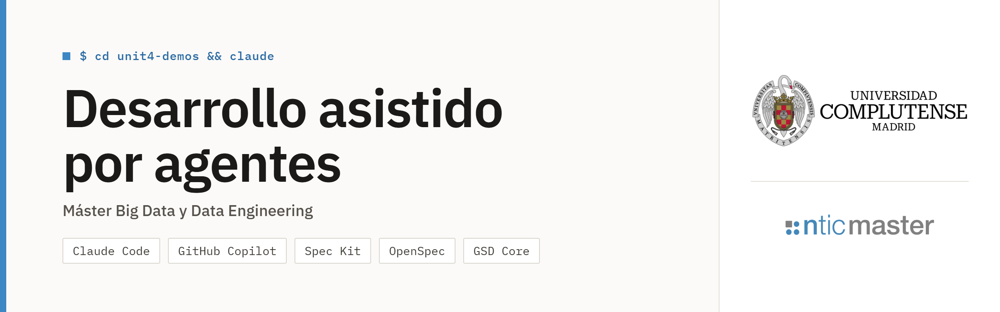

# Kivora · pipeline de ventas

> **Práctica final del módulo Desarrollo asistido por agentes.** El enunciado
> está en [`assignment.md`](assignment.md): léelo antes de empezar.

**Kivora** es una tienda online de moda y complementos con clientes en
España y en el resto de Europa, Reino Unido y Estados Unidos. Cada día, la
tienda deja en `data/inbox/<día>/` los pedidos, clientes y pagos nuevos o
modificados de ese día y, desde el 09-04, un `refunds.json` opcional con las
devoluciones. El formato de cada fuente está en [`docs/sources.md`](docs/sources.md).
Las marcas de tiempo vienen en UTC y los importes en la moneda de cada pedido.
Se convierten a EUR con `data/reference/fx_rates.csv`.

## Qué produce

`uv run python tasks.py run` lee todo `data/inbox/` y escribe en `output/`:

| Fichero | Qué es | Para quién | Definición |
| --- | --- | --- | --- |
| `daily_customer_metrics.csv` | Compras, devoluciones y neto por cliente y día natural en Madrid, en EUR | Finanzas ([KIV-101](docs/tickets/KIV-101.md)) | [`docs/specs/KIV-101/spec.md`](docs/specs/KIV-101/spec.md) §3.1 |
| `rejected.csv` | Cada pedido o devolución que no se usa, con su motivo | Finanzas | spec KIV-101 §3.2 |
| `quality_report.json` | Tres controles de calidad (`passed`, `failed_records`) | Finanzas, Plataforma | spec KIV-101 §3.3 |
| `daily_sales.csv` | Ventas por día y país | Dirección Comercial | [`docs/data-contracts/daily_sales.md`](docs/data-contracts/daily_sales.md) |
| `top_customers.csv` | Los diez clientes que más han comprado | Dirección Comercial | — |
| `warehouse.db` | SQLite con las tablas en bruto (`raw_*`, incluido `raw_refunds.reason`) y las intermedias | Equipo de datos | — |

`refunds.json` llega en dos formatos: `amount` hasta el 09-07, y `refund_amount` + `reason`
desde el 09-08. El pipeline acepta los dos ([KIV-102](docs/tickets/KIV-102.md),
[`docs/specs/KIV-102/spec.md`](docs/specs/KIV-102/spec.md)).

**Defecto conocido.** `daily_sales.csv` sale del SQL original y **no cumple su contrato**: no
convierte a EUR, no se queda con la última versión del pedido y usa el día UTC.
`top_customers.csv` arrastra los mismos fallos de divisas y de duplicidad. El análisis está en
[`docs/analysis.md`](docs/analysis.md) §2. Corregirlo quedó fuera del alcance de KIV-101
(decisión D5, spec KIV-101, A18). Por eso los totales de `daily_sales.csv` no coinciden con
los de `daily_customer_metrics.csv`.

## Estado actual

- `data/inbox/` trae los días 2026-09-01 a 2026-09-10 (entregas 1 y 2 ya recibidas).
- Tickets en `docs/tickets/`, cada uno con su respuesta:
  [KIV-100](docs/tickets/KIV-100.md) (incorporación y análisis),
  [KIV-101](docs/tickets/KIV-101.md) (devoluciones y métricas por cliente) y
  [KIV-102](docs/tickets/KIV-102.md) (dos formatos de `refunds.json`).

La tienda envía las entregas de datos con su ticket. Para simularlo, una sola vez, en orden y
en un commit propio:

```bash
uv run python tasks.py deliver 1   # días 4 a 7 y el ticket KIV-101
uv run python tasks.py deliver 2   # días 8 a 10 y el ticket KIV-102
```

## Cómo se ejecuta

Se necesitan [uv](https://docs.astral.sh/uv/), Git y Claude Code. `uv` descarga Python 3.12 si
no está instalado.

```bash
uv sync
uv run python tasks.py setup
uv run python tasks.py run
```

El equipo de Plataforma lanza el pipeline así, y esta interfaz **no se puede cambiar**. Las tres
opciones tienen esos valores por defecto:

```bash
uv run python -m kivora --inbox data/inbox --reference data/reference --out output
```

Termina con código 0 aunque haya rechazos o falle algún control de calidad: los fallos quedan en
`quality_report.json` y se avisan por consola. Solo lo detiene un `refunds.json` ilegible (JSON no
válido, o que no es una lista de objetos), con código ≠ 0 y un mensaje que nombra el fichero.

En Windows, macOS y Linux las órdenes son las mismas. Si activas el entorno virtual
(`.venv\Scripts\Activate.ps1` en PowerShell, `source .venv/bin/activate` en macOS y Linux),
puedes omitir `uv run`.

## Cómo se prueba

| Orden (`uv run python tasks.py …`) | Qué hace |
| --- | --- |
| `setup` | Comprueba la versión de Python y las dependencias |
| `run` | Ejecuta el pipeline sobre `data/inbox/` y escribe `output/` |
| `test` | Tests con pytest (`tests/`), sobre datos sintéticos en carpetas temporales |
| `check` | Comprobaciones básicas de `output/`: columnas, `gross_amount >= 0` y estructura de `quality_report.json` |
| `acceptance` | Oráculo de KIV-101 y KIV-102 (ver abajo); código 0 solo si pasan todos |
| `deliver N` | Recibe la entrega `N` de la tienda |
| `reset` | Borra `output/` |

`acceptance` (`kivora/acceptance.py`) nunca toca `data/inbox/`: trabaja sobre copias temporales.

- **E1–E19** (spec KIV-101 §5) sobre una copia de los días 09-01..09-07.
- **E20–E25** (spec KIV-102 §4) sobre una copia de 09-01..09-10.
- **Diferencial** en las dos copias: todas las filas y todos los rechazos deben coincidir con
  [`docs/specs/KIV-101/reference_calc.py`](docs/specs/KIV-101/reference_calc.py), un cálculo
  independiente.
- **Escenarios sintéticos S1–S14**, para casos que la muestra no trae. S13 y S14 se comprueban
  también sobre la referencia.

Un trabajo está terminado cuando `test`, `check` y `acceptance` están en verde.

## Cómo se trabaja con el agente

El equipo trabaja con agentes de código. La herramienta principal es **Claude Code**.

- **Instrucciones.** [`CLAUDE.md`](CLAUDE.md) resume el proyecto, los comandos verificados, lo
  que no se toca y cuándo está terminado un trabajo. [`AGENTS.md`](AGENTS.md) es una versión
  breve para otras herramientas, que remite a `CLAUDE.md`.
- **Primero la especificación.** El código no se modifica sin una spec aprobada en
  `docs/specs/<ticket>/`. Cada ticket pasa por análisis (`impact.md`), especificación
  (`spec.md`: decisiones, requisitos y escenarios) y plan (`plan.md`). Los escenarios se
  convierten en tests y en el oráculo antes de implementar, y se comprueba que fallan.
- **Protecciones** (`.claude/settings.json`). Hay permisos `allow` para los comandos de lectura
  y de verificación, y `deny` para `deliver`, `git push`, `git reset --hard`, `git rebase` y los
  borrados recursivos. Hay dos hooks:
  - `.claude/hooks/protect_inputs.py` (PreToolUse) bloquea las ediciones en `data/inbox/`,
    `data/reference/` y `deliveries/`.
  - `.claude/hooks/require_acceptance.py` (Stop) no deja cerrar un turno con cambios en código,
    SQL, tests o specs mientras `acceptance` esté en rojo.

  La justificación de cada una está en [`docs/report.md`](docs/report.md) §2.
- **Revisión independiente.** Un subagente sin el contexto de la sesión revisó el repositorio
  en solo lectura. Los hallazgos y las decisiones están en [`docs/review.md`](docs/review.md).
- **Trazabilidad.** Las sesiones exportadas están en `docs/sessions/` y la memoria del trabajo en
  `docs/report.md`.

## Estructura

```text
kivora-pipeline/
├── kivora/                 código del pipeline
│   ├── __main__.py         punto de entrada (python -m kivora)
│   ├── ingest.py           carga las fuentes en SQLite sin limpiarlas (y normaliza refunds.json)
│   ├── pipeline.py         orquesta la carga, el SQL y la exportación
│   ├── customer_metrics.py reglas de KIV-101 y KIV-102 (ventas, devoluciones, métricas, controles)
│   ├── outputs.py          escribe daily_customer_metrics, rejected y quality_report
│   ├── check.py            comprobaciones básicas de output/
│   └── acceptance.py       oráculo de KIV-101 y KIV-102 (python tasks.py acceptance)
├── sql/                    transformaciones en SQL de daily_sales y top_customers (SQLite)
├── tests/                  tests (pytest)
├── data/
│   ├── inbox/              entregas de la tienda: no se modifican nunca
│   └── reference/          tablas de referencia (tipos de cambio): no se modifican
├── deliveries/             entregas futuras, para python tasks.py deliver
├── docs/
│   ├── sources.md          formato de cada fuente
│   ├── data-contracts/     qué garantiza cada tabla de salida
│   ├── tickets/            peticiones de negocio y sus respuestas
│   ├── analysis.md         análisis del pipeline original (KIV-100)
│   ├── specs/              KIV-101 y KIV-102: impacto, especificación, plan y cálculo de referencia
│   ├── review.md           revisión independiente y decisiones
│   ├── report.md           memoria del trabajo con el agente
│   └── sessions/           sesiones de Claude Code exportadas
├── .claude/                permisos y hooks de Claude Code
├── CLAUDE.md               instrucciones del proyecto para Claude Code
├── AGENTS.md               instrucciones breves para otras herramientas
├── assignment.md           enunciado de la práctica
└── tasks.py                lanzador de tareas
```

Solo se usa la biblioteca estándar de Python (SQLite incluido), más `tzdata` para las zonas
horarias en Windows y `pytest` para los tests.
